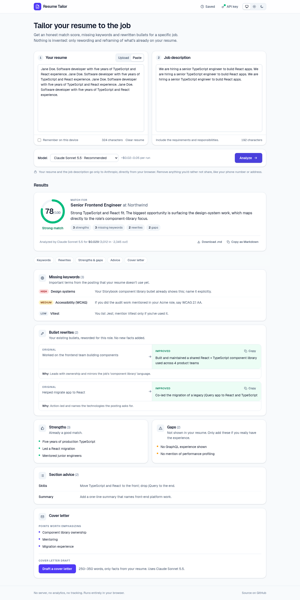

# resume-tailor

**Paste your resume and a job description; get specific, honest suggestions for tailoring the resume to that job, powered by Claude.**

**Live demo:** https://resume-tailor-jet.vercel.app



<sub>Screenshot shows sample output.</sub>

## Features

- **Match score** (0–100) with a one-paragraph summary of fit and the biggest opportunity.
- **Missing keywords** from the job description, ranked by importance, with advice on where to include them honestly.
- **Bullet rewrites** shown side by side with the original, each with a reason and a copy button.
- **Section advice**, **gaps** (requirements your resume doesn't show), and **cover letter points**.
- **Upload your resume as a PDF** (or .txt / .md), or paste it. Claude reads the PDF directly, so there's no lossy text extraction in the browser.
- **Cover letter draft** built from your resume and the analysis: 250–350 words, editable, with no invented experience and none of the gaps claimed.
- **Saved analyses** (opt-in): compare match scores across jobs, reopen past results, delete them any time.
- **Export** any analysis as Markdown, by download or copy.
- **Dark mode**: follows your system setting, or choose Light or Dark.
- **Streaming**: progress appears as soon as the model starts writing, and you can cancel at any time.
- **Actual cost per run**, calculated from the token counts Anthropic returns, not just an estimate.
- **Bring your own key.** Three models: Sonnet 5.5 (default), Haiku 4.5 (quick check), Opus 5.5 (deepest).
- Clear, human-readable errors for bad keys, rate limits, outages, network drops, refusals and truncated output, with retry where it makes sense.

## Tech stack

| Concern    | Choice                                                            |
| ---------- | ----------------------------------------------------------------- |
| Language   | TypeScript (`strict`, `noUncheckedIndexedAccess`)                 |
| UI         | React 19 + Vite                                                   |
| Styling    | Tailwind CSS v4, semantic colour tokens, Geist font (self-hosted) |
| AI         | `@anthropic-ai/sdk` (browser mode), structured outputs            |
| Validation | Zod                                                               |
| Tests      | Vitest + React Testing Library (jsdom)                            |
| Lint       | ESLint (typescript-eslint `strictTypeChecked`) + Prettier         |
| Hosting    | Vercel (static), with a Content-Security-Policy                   |

## Run locally

Requires Node 20+.

```bash
npm install
npm run dev        # http://localhost:5173
npm test           # unit + component tests
npm run check      # typecheck + lint + format check + tests
npm run build && npm run preview   # production build, served with the production security headers
```

You'll need an Anthropic API key from [console.anthropic.com](https://console.anthropic.com/settings/keys). Tests never call the real API.

## How it works

```
components ──▶ hooks (state machines) ──▶ AnalysisProvider ──▶ Anthropic Messages API
                 │                          analyze()            (streamed, from the browser)
                 │                          draftCoverLetter()
                 └──▶ parseJson + Zod ──▶ ResultView
```

- `src/schemas/analysis.ts`: the Zod schema. The TypeScript type is inferred from it, **and** it generates the JSON Schema sent to the API, so it's the single source of truth.
- `src/prompts/`: system prompts and message builders for the analysis and the cover letter (pure functions, unit tested).
- `src/services/provider.ts`: the `AnalysisProvider` interface; `anthropic.ts` implements it, with both tasks sharing one streaming helper.
- `src/hooks/`: request lifecycles as discriminated unions (`idle | loading | streaming | success | error`), plus opt-in persistence for the key, resume, history and theme.
- `src/config/models.ts`: model IDs, prices, token caps and effort in one typed list.
- `src/index.css`: semantic colour tokens; dark mode swaps their values instead of adding `dark:` variants everywhere.

Components never call the API directly.

## Design decisions

**Why bring your own key?** The app has no backend, so there's nothing to pay for per user and nothing to secure on a server. Each user's usage is billed to their own Anthropic account.

**Why do keys stay in the browser?** The key goes straight from your browser to `api.anthropic.com` and nowhere else. It's kept in memory by default; "Remember my key on this device" is opt-in, uses `localStorage`, and "Clear key" removes it. The Content-Security-Policy only allows network requests to this site and to `api.anthropic.com`, so even injected code couldn't send the key elsewhere. The SDK requires `dangerouslyAllowBrowser: true` for this; the flag exists to stop developers shipping _their own_ key to users, which is not what's happening here.

**Why validate AI output with Zod?** Model output is untrusted input. The request uses Anthropic's structured outputs to constrain the response to the schema, but constrained decoding supports only part of JSON Schema. Numeric bounds, for example, are dropped, so the 0–100 score range is only enforced by Zod. Validation also catches truncated or malformed responses. If validation fails, the app retries once automatically, then shows a friendly error with the raw text available.

**Why stream?** A careful analysis takes a while. Streaming shows progress as soon as the model starts writing, lets you cancel, and means an interrupted response isn't lost: whatever arrived is kept and shown.

**Why the "no fabrication" rule?** A tailored resume is only useful if every line is true. The system prompt forbids inventing skills, employers, titles, dates or metrics. Requirements the resume doesn't show go under **Gaps** instead of being written in. Pasted text is treated as data, not instructions, so a job posting can't tell the model to inflate the score.

**Why show actual cost?** Sonnet and Opus think before answering, and thinking tokens are billed as output, so any upfront estimate is a range. After each run the app shows the real cost from the token counts the API reports. Each model also has a `max_tokens` cap so a runaway response can't cost much.

**Why send PDFs to the model instead of parsing them?** Extracting text from a PDF in the browser needs a large library and often scrambles columns and bullets. Claude reads the PDF itself, layout included, for roughly 1.5–3K extra input tokens per page. No new dependency was needed.

**Why is history opt-in and resume-free?** Analyses quote your resume, so nothing is kept unless you turn history on. Even then, entries store the job description and results but never the resume itself, which has its own separate opt-in. Everything read back from storage is validated with Zod, just like model output.

**Why no automatic model fallback?** If the model declines a request, the app says so plainly instead of quietly re-running it on a different model you didn't choose and paying for that.

## Privacy

- No backend, no analytics, no tracking, no cookies.
- Your resume, the job description and your API key are sent **only** to Anthropic's API, directly from your browser.
- Nothing is stored unless you opt in, and everything opt-in lives only in your browser's local storage:
  - "Remember my key": your API key.
  - "Remember my resume": your pasted text and/or PDF (PDFs up to 2 MB).
  - "Save analyses": results and job descriptions, never your resume.
  - Your theme choice (Light/Dark), if you change it from System.
- Turning an option off, or using its Clear button, deletes what it stored.
- Anthropic's handling of API data is covered by [their privacy policy](https://www.anthropic.com/legal/privacy). Don't include anything you wouldn't want sent to an AI provider.

## Roadmap

**Done:** Phase 1 (MVP) and Phase 2 (PDF upload, saved resume, history, dark mode, cover letters, Markdown export).

**Phase 3**

- More providers (OpenAI, Gemini) via the `AnalysisProvider` interface
- Multiple resume versions
- Browser extension or bookmarklet to grab the job description from the current tab
